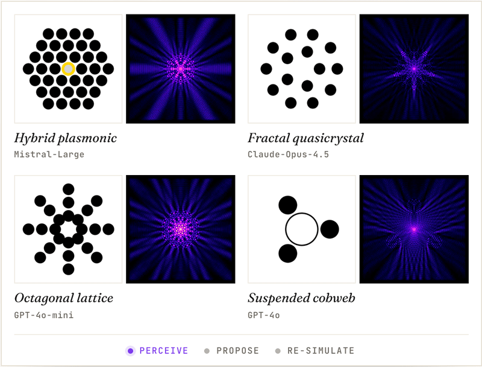

<div align="center">


# PCFBench

### How Far Can Large Vision-Language Models Go in Physics-aware Photonic Inverse Design?

[](https://pcfbench.github.io/)
[](https://pcfbench.github.io/)
[](https://huggingface.co/datasets/PCF-Bench/PCF-Bench)
[](https://www.python.org/)
[](#license)

[**Project page**](https://pcfbench.github.io/) ·
[**Leaderboard**](https://pcfbench.github.io/#leaderboard) ·
[**Dataset**](https://huggingface.co/datasets/PCF-Bench/PCF-Bench) ·
[**Quickstart**](#-quickstart) ·
[**Tasks**](#-task-catalogue)



</div>

---

## 📰 News

- 🎉 PCFBench has been accepted to the **NeurIPS 2026 Track on Evaluations and Datasets**.
- 🌐 The project page is live at **[pcfbench.github.io](https://pcfbench.github.io/)**, with the full leaderboard, interactive samples and real design-loop case studies.
- 🤗 The dataset is available on [Hugging Face](https://huggingface.co/datasets/PCF-Bench/PCF-Bench).

---

PCFBench evaluates vision-language models (VLMs) on the complete inverse-design workflow for photonic crystal fibres (PCFs). It spans 26 tasks in six categories of increasing cognitive demand, built from over 220K FDTD simulation samples across 18 fibre families. This repository holds the evaluation suite used in the paper, with the task prompts, output extractors and metrics, a configuration-driven CLI, and the multi-agent baselines.

## ✨ Highlights

| | |
| --- | --- |
| 🧩 **26 tasks, 6 categories** | Geometry · Physics · Text · Multimodal · Inverse Design · Code Generation, plus the four-stage Sequential Pipeline in cascaded and oracle modes (28 registered task names) |
| 🔌 **OpenRouter, multi-key pool** | One OpenAI-compatible provider covers the paper's 41-VLM cohort, with round-robin across any number of OpenRouter keys |
| 🤖 **12 MAS baselines** | Vanilla · CoT · Self-Consistency · LLM-Debate · MAD · CAMEL · AutoGen · AgentVerse · DyLAN · MacNet · EvoMAC · MAV |
| 🎛 **One config, one CLI** | A single pydantic-validated YAML drives every run, and nine subcommands cover the full life-cycle |
| 📊 **Standard outputs** | Each run emits `<id>.json`, `<id>.csv` (leaderboard-ready) and `<id>.md` (human summary) |

---

## 📚 Table of Contents

1. [Quickstart](#-quickstart)
2. [Installation](#-installation)
3. [Task catalogue](#-task-catalogue)
4. [CLI reference](#-cli-reference)
5. [Configuration](#-configuration)
6. [Supported provider](#-supported-provider)
7. [Multi-agent (MAS) evaluation](#-multi-agent-mas-evaluation)
8. [Evaluate your own model](#-evaluate-your-own-model)
9. [Repository layout](#-repository-layout)
10. [License](#license)

---

## 🚀 Quickstart

```bash
# 1. install
git clone https://github.com/shengchaochen82/PCF-Bench-Eval.git && cd PCF-Bench-Eval
pip install -e .

# 2. set provider keys (any number, used round-robin)
export OPENROUTER_API_KEY_1=sk-or-...
export OPENROUTER_API_KEY_2=sk-or-...

# 3. scaffold a config (the dataset is materialized automatically on first eval)
pcfbench init my_run --dataset PCF-Bench/PCF-Bench
# or, for a local parquet copy:
# pcfbench init my_run --dataset '/data/PCF-Bench-HF/data/full-*.parquet'

# 4. run
pcfbench eval --config my_run.yaml
#   the first run materializes the dataset once into output_dir/.cache/<slug>,
#   and later runs reuse it. Set cache_dir: in the YAML to move it.
```

You'll see live progress per task, then artefacts under `results/`:

```
results/
├── my_run_2026...Z.json    # full record (config + per-sample results)
├── my_run_2026...Z.csv     # one row per task, leaderboard-friendly
└── my_run_2026...Z.md      # human-readable summary
```

> **Tip.** No install? `./bin/pcfbench …` works straight from the checkout. It is the same CLI, run from the local source.

---

## 📦 Installation

**Requirements**: Python ≥ 3.10.

```bash
pip install -e .                 # core
pip install -e .[mas]            # + scipy/Pillow for some MAS baselines
```

**One-liner for a clean conda env**:

```bash
conda create -n pcfbench python=3.10 -y && conda activate pcfbench
pip install -e .
```

Verify the install:

```bash
pcfbench info     # shows provider key detection + python/openai/pydantic versions
pcfbench tasks    # lists all 28 registered tasks
```

---

## 🧩 Task catalogue

PCFBench organises its 26 tasks into six categories of increasing cognitive demand, and the multi-agent track adds two registered pipeline tasks (27 and 28). Each task ships an instruction prompt, an output extractor and a primary metric. Run `pcfbench tasks` to print the live registry. The tables below summarise it by category.

<details>
<summary><b>Geometry Perception</b> (5 tasks)</summary>

| # | Task name | Image | Primary metric |
|---|---|---|---|
| 1 | `family_classification` | structure | Accuracy + Macro-F1 |
| 2 | `parameter_prediction_pitch` | structure | NRMSE↓ |
| 3 | `parameter_prediction_hole_d` | structure | NRMSE↓ |
| 4 | `structure_counting_rings` | structure | Exact-match Acc |
| 5 | `topology_recognition` | structure | Accuracy + Macro-F1 |
</details>

<details>
<summary><b>Physics Understanding</b> (5 tasks)</summary>

| # | Task name | Image | Primary metric |
|---|---|---|---|
| 6 | `loss_prediction_1310` | field_1310 | Log-MAE↓ |
| 7 | `loss_prediction_1550` | field_1550 | Log-MAE↓ |
| 8 | `application_classification` | field_1550 | Accuracy + Macro-F1 |
| 9 | `mode_classification` | field_1550 | Accuracy + Macro-F1 |
| 10 | `mechanism_reasoning` | structure | Mean keyword recall |
</details>

<details>
<summary><b>Text Generation</b> (3 tasks)</summary>

| # | Task name | Image | Primary metric |
|---|---|---|---|
| 11 | `geometry_description` | structure | BERTScore-F1 |
| 12 | `conversation_qa` | field_1550 | BERTScore-F1 |
| 13 | `report_generation` | structure + field_1550 | Completeness |
</details>

<details>
<summary><b>Multimodal Reasoning</b> (6 tasks)</summary>

| # | Task name | Image | Primary metric |
|---|---|---|---|
| 14 | `wavelength_comparison_v1` (Paired) | structure + field_1310 + field_1550 | Accuracy |
| 15 | `wavelength_comparison_v2` (Field-only) | field_1310 + field_1550 | Accuracy |
| 16 | `mechanism_diagnosis_v1` (Paired) | structure + field_1550 | Macro-F1 |
| 17 | `mechanism_diagnosis_v2` (Field-only) | field_1550 | Macro-F1 |
| 18 | `evidence_explanation_v1` (Paired) | structure + field_1550 | BERTScore-F1 |
| 19 | `evidence_explanation_v2` (Field-only) | field_1550 | BERTScore-F1 |
</details>

<details>
<summary><b>Inverse Design</b> (4 tasks)</summary>

| # | Task name | Image | Primary metric |
|---|---|---|---|
| 20 | `parameter_selection_v1` | structure + field_1550 | Accuracy + Macro-F1 |
| 21 | `design_direction_pitch` | structure + field_1550 | Acc + binary F1 |
| 22 | `design_direction_hole_d` | structure + field_1550 | Acc + binary F1 |
| 23 | `closed_loop_improvement_pitch` | structure + field_1550 | Success Rate |
</details>

<details>
<summary><b>Code Generation</b> (3 tasks)</summary>

| # | Task name | Image | Primary metric |
|---|---|---|---|
| 24 | `simulation_code_generation_complete` | structure | Quality score Q |
| 25 | `parameter_modification_complete` | structure | Syntax + completeness |
| 26 | `code_refactoring` | structure | Q<sub>refactor</sub> |
</details>

<details>
<summary><b>Multi-Agent Pipeline</b> (2 registered tasks)</summary>

| # | Task name | Image | Primary metric |
|---|---|---|---|
| 27 | `mas_pipeline_cascaded` | full | E2E success + per-stage breakdown |
| 28 | `mas_pipeline_oracle` | full | E2E success + per-stage breakdown |
</details>

---

## 🛠 CLI reference

A single command with nine subcommands:

```
pcfbench info                              Show provider keys + Python env diagnostic.
pcfbench fetch --out-dir D                 Pre-materialize the dataset (optional,
       (--repo-id REPO | --shards-glob G)    eval materializes it on first run).
       [--max-samples N] [--streaming]
pcfbench tasks [--filter STR]              List the 28 registered tasks
                                           (filters on task name or category).
pcfbench init NAME                         Scaffold a YAML config from a template.
       [--template TPL] [--path P] [--dataset SRC] [--force]
pcfbench validate CONFIG                   Type-check a config.
pcfbench eval --config CONFIG              Run a configured evaluation.
       [--override-model M]                  swap cfg.model for sweeps
       [--override-dataset SRC]              swap cfg.dataset (HF repo or parquet glob)
       [--override-max-samples N]
       [--dry-run]                           same as `validate`
pcfbench score RUN.json [--output-dir D]   Re-render JSON → CSV + Markdown.
pcfbench compare LEFT.json RIGHT.json      Print a Δ-table between two runs.
pcfbench mas-eval --method M --data_dir D  Run a MASLab multi-agent baseline
       --model M [--method_config NAME]      (DyLAN, MacNet, AutoGen, EvoMAC,
       [--maslab_config FILE.json]           CAMEL, MAV, AgentVerse, MAD,
       [--subset_manifest FILE.json]         LLM-Debate, Self-Consistency,
       [--max_samples N] [--num_workers W]   CoT, Vanilla) on PCFBench data
       [--no-score] [--output_dir D]         and score it.
```

**Examples**:

```bash
pcfbench tasks --filter physics              # list physics-understanding tasks
pcfbench eval --config my.yaml \
              --override-model openai/gpt-4o \
              --override-max-samples 100     # quick smoke test
pcfbench compare results/baseline.json results/improved.json
```

---

## 🎛 Configuration

The full schema lives in `pcfbench/config.py`. Unknown fields raise `ValidationError` immediately, so typos are caught before any model call.

```yaml
run_name: my_run

# Parquet input: a HuggingFace repo id, or a local glob over parquet shards.
dataset: PCF-Bench/PCF-Bench
# dataset: /data/PCF-Bench-HF/data/full-*.parquet

# Optional. Default: '<output_dir>/.cache/<dataset_slug>'.
# cache_dir: /scratch/pcfbench-cache

output_dir: results

provider:
  name: openrouter           # the only supported provider in the public release
  timeout_s: 120
  max_retries: 3

model: openai/gpt-4o-mini    # any OpenRouter model id

api_keys_env:                # round-robin pool, up to 100 keys
  - OPENROUTER_API_KEY_1
  - OPENROUTER_API_KEY_2

tasks: all                   # or a list, e.g. [family_classification, loss_prediction_1550]
max_samples: 200
# subset_manifest: path/to/subset.json   # optional stratified subset

runner:
  num_workers: 16
  rpm_limit: 600
  temperature: 0.1
  max_tokens: 2048

# mas:                        # only for tasks 27/28
#   mode: pcfbench            # or maslab
#   method: dylan
```

Three ready-to-use templates ship in `examples/`:

| Template | Purpose |
| --- | --- |
| `examples/single_model.yaml` | one model on all tasks (default) |
| `examples/multi_model.yaml`  | sweep skeleton, pair with `--override-model` |
| `examples/mas.yaml`          | sequential MAS pipeline or MASLab-bridged method |

---

## 🔌 Supported provider

The public release routes every model through **OpenRouter**, so the same 41-VLM cohort can be evaluated under one OpenAI-compatible API without per-vendor SDK plumbing. Supply one or more `OPENROUTER_API_KEY_*` environment variables and the round-robin pool will use them all.

| Provider | env-var pattern | base URL |
| --- | --- | --- |
| `openrouter` | `OPENROUTER_API_KEY_*` | `https://openrouter.ai/api/v1` |

Set `model:` in your config to any OpenRouter id (`openai/gpt-4o-mini`, `anthropic/claude-sonnet-4.5`, `google/gemini-2.5-pro`, `qwen/qwen2.5-vl-72b-instruct`, ...). The client is `OpenRouterClient` in `tools/llm_client.py`.

---

## 🤖 Multi-agent (MAS) evaluation

Two complementary entry points cover the 13 multi-agent methods in the paper.

**(a) Native Sequential Pipeline.** Four stages (Perception → Understanding → Reasoning → Design), registered as the tasks `mas_pipeline_cascaded` and `mas_pipeline_oracle` and run with the standard `pcfbench eval`. In cascaded mode each stage receives the parsed outputs of the previous stages, and in oracle mode it receives the ground-truth values instead.

```bash
pcfbench init mas_native --dataset PCF-Bench/PCF-Bench
# edit tasks: [mas_pipeline_cascaded, mas_pipeline_oracle]
pcfbench eval --config mas_native.yaml
```

**(b) MASLab baselines.** DyLAN, MacNet, AutoGen, EvoMAC, MAV, AgentVerse, CAMEL, Self-Consistency, CoT, LLM-Debate, MAD and Vanilla, bundled under `MAS/`. Each consumes the same enriched query and is scored on the same PSel / Direction / Closed-Loop rubric. These baselines read their endpoints from a MASLab model config, so copy the example once and fill in your OpenRouter key:

```bash
cp MAS/model_api_configs/openrouter_config.example.json \
   MAS/model_api_configs/openrouter_config.json      # git-ignored

pcfbench mas-eval --method dylan \
    --model openai/gpt-4o-mini \
    --data_dir results/.cache/<your-slug> \
    --max_samples 200
```

`--model` must match a key in that config file exactly (for example `openai/gpt-4o-mini`, not `gpt-4o-mini`). The wrapper invokes `scripts/mas/run_mas_benchmark.py` (per-sample inference) followed by `scripts/mas/score_maslab_results.py` (PSel + Direction + CL accuracy) and writes a `*_scored.json` next to the raw output. Method classes live in `MAS/methods/<method>/`, following the upstream [MASLab](https://github.com/MASWorks/MASLab) layout. The Human Score (HS) in the paper's multi-agent table is an expert rating described in the paper's appendix, and this script does not compute it.

---

## 🚢 Evaluate your own model

If your model is on OpenRouter, pass its id:

```bash
export OPENROUTER_API_KEY_1=sk-or-...
pcfbench eval --config my.yaml --override-model vendor/your-model-id
```

If it runs behind your own OpenAI-compatible endpoint (vLLM, SGLang, ...) with vision support for the image-conditioned tasks, point `base_url` at it:

```yaml
provider:
  name: openrouter
  base_url: http://localhost:8000/v1
model: your-local-model
api_keys_env: [LOCAL_API_KEY]   # export LOCAL_API_KEY=dummy if your server ignores keys
```

For models with non-OpenAI APIs, subclass `BaseLLMClient` in `tools/llm_client.py`, return it from `get_llm_client` under a new provider name, and add that name to `PROVIDERS` in `pcfbench/config.py`. This takes about 50 lines of code.

---

## 📂 Repository layout

```
PCF-Bench-Eval/
├── pcfbench/             ← public package: CLI + runner + config + reporting
│   ├── cli.py            9 subcommands
│   ├── config.py         pydantic v2 schema
│   ├── fetch.py          HF repo / parquet shards → per-sample directories
│   ├── providers.py      multi-key round-robin client
│   ├── runner.py         orchestrator over eval/tasks/*
│   └── reporting.py      JSON / CSV leaderboard / Markdown
├── eval/                 ← task and metric implementations
│   ├── tasks/            21 task classes, 28 registered task names
│   └── metrics/          classification / regression / generation / code
├── tools/                ← minimal supporting modules
│   ├── llm_client.py     OpenAI-compatible client (OpenRouter)
│   ├── env_utils.py      API-key / worker / RPM discovery
│   └── io_utils.py       atomic-write JSON
├── MAS/                  ← bundled MASLab baselines and model configs
├── scripts/mas/          ← inference + scoring behind `pcfbench mas-eval`
├── bin/pcfbench          ← zero-install launcher
├── examples/             ← 3 starter configs
├── pyproject.toml
├── requirements.txt
└── README.md             ← you are here
```

---

## License

The evaluation suite is released under the [MIT License](LICENSE). The PCFBench dataset is distributed separately on [Hugging Face](https://huggingface.co/datasets/PCF-Bench/PCF-Bench) under CC BY 4.0.

---

<div align="center">
<sub>NeurIPS 2026 · Track on Evaluations and Datasets. Issues, discussions and pull requests are welcome.</sub>
</div>
